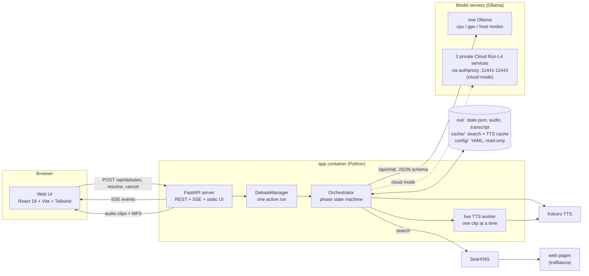
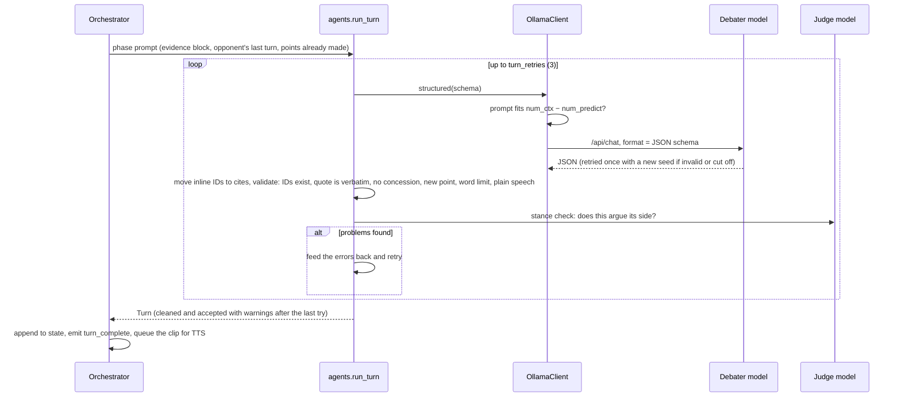

# tech-debate

Two open models debate a tech topic using real web evidence. A third model judges, and Kokoro reads the whole thing aloud. You get an MP3, captions and a cited transcript.

Everything runs locally with one command. No API keys and no accounts are needed.

| Service | Role |
|---|---|
| **Ollama** | runs the models, with JSON-schema structured output |
| **SearXNG** | self-hosted meta-search (JSON API) |
| **Kokoro** (via Kokoro-FastAPI) | text-to-speech on CPU or GPU |
| **app** | Python orchestrator (debate state machine, evidence ledger, judge, audio stitching) plus the web UI on port 8000 |
| **model-init** | one-shot container that pulls the pinned models on first start |

Default lineup (edit `config/debate.yaml`):

| Role | Model | Voice |
|---|---|---|
| Pro (for) | `qwen3:4b` | `am_michael` |
| Con (against) | `gemma3:4b` | `bf_emma` |
| Judge + narrator | `llama3.2:3b` | `bm_george` |

## Quickstart

```bash
git clone <this repo> && cd tech-debate
docker compose up          # cpu profile: pulls models, then serves the web UI
```

Open http://localhost:8000, pick a motion, the models, the number of rebuttal rounds and the speech length, and press **Start debate** (see [Web UI](#web-ui)). Runs land in `out/<timestamp>-<slug>/`. For how the pieces fit together, see [Architecture](#architecture).

For repeated use, the Makefile is nicer:

```bash
make up                                   # start services + pull models + web UI (MODE auto-detected)
make demo                                 # canned topic, from the command line
make debate TOPIC="Rust is better than Go for command-line tools"
make debate TOPIC="..." ROUNDS=5 LENGTH=long   # 1-10 rebuttal rounds; short | standard | long speeches
make replay RUN=out/<run-dir>             # same topic + queries, search served from cache only
make resume RUN=out/<run-dir>             # continue an interrupted run with its saved rounds and length
make render RUN=out/<run-dir>             # rebuild transcript/SRT/MP3, no LLM calls
make down
```

### Modes

| `MODE` | Ollama | Kokoro | When to use it |
|---|---|---|---|
| `cpu` (default for bare `docker compose up`) | container | CPU container | Works anywhere with Docker |
| `gpu` | container with NVIDIA GPU | GPU container | Linux/WSL with an NVIDIA card and the NVIDIA Container Toolkit |
| `host` (auto-picked on macOS when `ollama` is installed) | **your own Ollama** | CPU container | Apple Silicon. Docker on macOS can't use Metal, so native Ollama is several times faster |
| `cloud` | **Cloud Run GPUs**, one private service per model, scale-to-zero | CPU container | Bigger models (up to ~20B) without local hardware. See [gcp/README.md](gcp/README.md) |

With `make`, set the mode with `make up MODE=gpu` and so on. With plain compose, set it with `COMPOSE_PROFILES=gpu docker compose up`.

In host mode, model-init pulls the models into your local Ollama. On Linux, host mode needs Ollama listening on the Docker bridge: `OLLAMA_HOST=0.0.0.0 ollama serve`.

## Web UI

`make up` (or `docker compose up`) serves it at **http://localhost:8000**. It is styled as pen and paper: warm paper, ink text, handwritten headings and margin notes, with a "night paper" variant that follows your system setting (or pick one with the toggle in the corner).
- **Set up a debate:** a preset or custom motion; which model plays Pro, Con and Judge; **rebuttal rounds** (1–10, default 2); and **speech length** (Short, Standard or Long). An estimate of the audio length updates as you choose.
- **The stage:** Pro and Con at their podiums, the judge at the bench. Whoever is speaking glows, and their mouth and a waveform move with the real audio. While a model is writing, its avatar looks down with a pen scribbling, and the line underneath says what it's doing (drafting, a rejected draft being retried, the judge's stance check).
- **The transcript:** written on ruled paper, phase by phase. Rebuttals show the quoted opponent line as a pasted-in clipping. Sources and each speech's main point sit in the margin; click a source for its snippet. During playback, the sentence being spoken is highlighted and its words ink in one by one. The page follows the speaker until you scroll yourself; a "follow along" button brings it back.
- **Timeline:** Research · Openings · R1…Rn · Closings · Verdict. Click a step to jump to it.
- **Research notes:** the queries each side searched for and every evidence passage, folded by default, with Pro/Con filters and search.
- **Verdict:** a scorecard with both judge passes and whether they agreed.
- **Audio:** each speech is voiced as soon as it's accepted and plays while the next one is being written ("speech by speech"). When the debate ends, the full recording is available; click any sentence to jump to it.
- **Notebook:** every run in `out/` is listed with its verdict and round count, with cancel and resume.

The server only listens on `127.0.0.1`. It refuses state-changing requests from other websites, because debates in cloud mode cost GPU time.

**Running it on the host instead of in Docker:**

```bash
make serve                       # API + built UI on 127.0.0.1:8000 (needs `npm run build` in web/ first)
cd web && npm ci && npm run dev  # UI dev server on :5173, proxying /api to :8000
```

The command-line tools (`make debate`, `make demo`, `make replay`, `make render`) work as before and share the same `out/` folder.

## What you get

```
out/20261029-153000-monorepos-are-better-than-polyrepos/
  debate.mp3        stitched audio (narrator intro, all turns, verdict)
  debate.srt        one caption per spoken sentence, speaker-tagged
  debate.wav        lossless master
  transcript.md     turns, quoted rebuttal targets, footnoted sources, score table
  judge.json        both judge passes, averaged scores, position-consistency flag
  evidence.json     the evidence ledger (E1, E2, …) with URLs and snippets
  state.json        full checkpoint; `make resume` / `make render` read it
```

## Architecture

### Services



- **app** is one Python process. It serves the built UI from `web/dist`, the REST API and a Server-Sent Events stream, and runs at most **one debate at a time** in a background thread (a second start returns 409). The CLI (`python -m app debate …`) runs the same `Orchestrator` without the server.
- **Ollama** answers every model call. In local modes, one Ollama serves all three roles. In cloud mode, each role has its own URL (`OLLAMA_URL_PRO`, `_CON`, `_JUDGE`), pointing at `gcp/authproxy.py` tunnels to three private, scale-to-zero Cloud Run GPU services. Swapping roles in the UI still sends each model to the service that holds it.
- **SearXNG** finds pages, which the app fetches and extracts with trafilatura. **Kokoro** turns each sentence into speech.
- **Disk is the source of truth.** Each run is a folder in `out/` whose `state.json` is rewritten after every phase. The server lists runs by scanning `out/`; resume, render and replay all start from `state.json`.

### Configuration, per run

```
config/debate.yaml ─┬─ deep-merge config/debate.<profile>.yaml (DEBATE_PROFILE=cloud)
                    └─ + service URLs from the environment         → Config (app/config.py)

per debate:  Config.with_role_models({pro, con, judge})               chosen models
                   .with_debate_settings(rounds, speech_length)       rounds 1-10, word limits
on resume:   cfg_for_state(Config, state)                             the same, read back from state.json
```

The resulting run config decides the phase plan (`research, openings, rebuttal_1 … rebuttal_N, closings, judge, render`), the word limits in every prompt and check, and which URL each model is called on. `state.json` stores `rebuttal_rounds` and `speech_length`. Runs saved before those settings existed load with the config defaults.

### Life of a debate

1. **Start.** `POST /api/debates` with the motion, models, rounds and speech length. The server validates them (422 on unknown models, rounds outside 1–10, unknown lengths), runs the topic denylist, writes an empty `state.json`, and starts a worker thread.
2. **Prepare.** The worker waits until every model server answers. With `llm.warm_up` (cloud) it also loads all models in parallel, so Cloud Run cold starts overlap. It then runs the model half of the topic gate.
3. **Run the phases.** `Orchestrator.run` walks the phase plan, skipping phases already in `phases_done` (that's how resume works). After each phase it records the timing, appends to `phases_done` and saves `state.json`.
   - **Research:** writes the counter-claim used by the stance check, then for each side generates queries, searches, fetches and adds passages to the evidence ledger as `E1`, `E2`, …
   - **Openings, rebuttals, closings:** one turn per side (below).
   - **Judge:** two passes over an anonymised transcript, sides swapped, averaged.
   - **Render:** waits for the live clips, then writes `transcript.md`, `evidence.json`, `judge.json`, the SRT and the stitched WAV/MP3.
4. **Stream.** Every step is broadcast as an event to all SSE subscribers. The browser gets a full snapshot when it connects, then applies events on top, and reconnects with backoff if the stream drops.
5. **Cancel or fail.** Cancelling stops at the next check. The server reloads `state.json`, which drops the half-finished phase, and deletes audio clips for turns that were discarded, so the page shows exactly what **Resume** continues from.

### One turn



Live audio runs beside this: each accepted turn is queued on a single-worker TTS pool, and a `segment_audio_ready` event announces the clip, so the browser plays one speech while the next one is being written.

### API

| Method and path | Purpose |
|---|---|
| `GET /api/models` | profile, allowed models, role defaults, preset motions, `debate_options` (round limits, speech-length presets), the active run |
| `GET /api/debates` | every run in `out/`: status, verdict, round count |
| `GET /api/debates/{id}` | full detail: state, phase plan, rounds, speech length, captions, audio clips |
| `POST /api/debates` | start: `topic`, `models`, `rebuttal_rounds`, `speech_length` |
| `POST /api/debates/{id}/resume` · `/cancel` | continue an interrupted run · stop the active one |
| `GET /api/debates/{id}/events` | SSE: a `snapshot`, then events (below) |
| `GET /api/debates/{id}/audio/master` · `/audio/segments/{file}` | the full recording · one speech's clip |

Events: `service_status`, `service_log`, `topic_gate`, `phase_start`, `phase_done`, `counter_claim`, `research_status`, `research_queries`, `evidence_added`, `turn_attempt` (generating, stance check, rejected), `turn_complete`, `segment_audio_ready`, `judge_start`, `judge_complete`, `render_status`, `render_complete`, `debate_cancelling`, `debate_done`, `debate_cancelled`, `debate_error`.

State-changing requests from other origins are refused, and the port is published on `127.0.0.1` only.

### Web UI

```
App.tsx
 ├─ useDebateStream   snapshot + SSE events → the selected debate's live detail
 ├─ useAudioPlayer    the single <audio> element: full recording or speech-by-speech clips, live auto-play queue
 ├─ useSpeech         playback time + captions → which sentence of which turn is being spoken, and who is on the stage
 ├─ useTheme          day paper / night paper / system
 └─ components
     Composer       motion, models, rounds stepper, speech length, start/stop
     RunList        past runs (the notebook)
     PhaseTimeline  progress, click to jump
     Stage          podiums + bench (Avatar), waveform from useAudioLevel (Web Audio analyser)
     ResearchNotes  queries and evidence ledger
     Transcript     ruled sheet → TurnEntry per speech: quote clipping, word-by-word inking, margin sources
     Verdict        scorecard
     AudioBar       player controls
```

The audio element is mounted once and wired to a Web Audio analyser only once (`createMediaElementSource` can't be called twice on the same element). Only the stage re-renders at animation speed; transcript entries are memoised, so only the speech being spoken updates as words ink in.

### Code map

| Path | What it does |
|---|---|
| `app/__main__.py` | CLI: `serve`, `debate`, `demo`, `replay`, `resume`, `render`, `check-topic` |
| `app/server.py` | FastAPI app, `DebateManager` (one active run, worker thread, SSE fan-out) |
| `app/orchestrator.py` | phase plan and state machine, live TTS queue |
| `app/agents.py` | prompts, output schemas, turn validation, stance check, retries |
| `app/judge.py` | two-pass rubric judge and score averaging |
| `app/llm.py` | Ollama client: JSON-schema output, context guard, retries, model warm-up |
| `app/state.py` | `DebateState`, phases (up to `rebuttal_10`), phase titles |
| `app/ledger.py` | evidence ledger (`E1`, `E2`, …) |
| `app/config.py` | config loading, profile overlay, per-run model and debate settings |
| `app/safety.py` | topic gate |
| `app/render.py` | transcript, captions, per-speech clips, stitched WAV/MP3 |
| `app/tools/search.py` | SearXNG search, page fetch and extraction, disk cache, replay |
| `app/tools/tts.py` | speech cleanup, pronunciations, Kokoro client |
| `app/model_init.py` | init container: pull models, check `models.lock` |
| `web/src/` | the web UI (above) |
| `gcp/` | Cloud Run setup, deploy, auth proxy, status and teardown scripts ([gcp/README.md](gcp/README.md)) |
| `tests/` | unit tests with scripted models, search and TTS; no services needed |

## How a debate runs

It's a fixed state machine, not free-form agents chatting, so it stays on topic and always ends.

```
0. Topic gate  → denylist + model check that the topic is about tech
1. Research    → each side writes 3 queries → SearXNG → fetch top pages → trafilatura
                 → best-matching passage stored in the evidence ledger as E1, E2…
2. Openings    → Pro, then Con (must cite ledger IDs)
3. Rebuttals   → 1-10 rounds (default 2); each must quote the opponent verbatim and attack that line
4. Closings    → one sentence each
5. Judge       → rubric JSON, run twice with sides anonymised and order swapped, averaged
6. Render      → per-sentence TTS → WAV/MP3 + SRT + transcript.md
```

Each turn is requested as structured JSON (Ollama `format` with a JSON schema) and **validated in code**:
- **Citations** must be IDs that exist in the ledger. Models never write URLs.
- **Rebuttal quotes** must appear (near-)verbatim in the opponent's last turn.
- **Concessions** ("I agree", "fair point", …) are rejected.
- **New points** are checked against that side's earlier points and rejected if they are near-duplicates.
- **Word limits** are enforced. They come from the debate's speech length:

  | Speech length | Opening | Rebuttal | Closing |
  |---|---|---|---|
  | Short | 80 | 70 | 25 |
  | Standard (default) | 120 | 110 | 30 |
  | Long | 200 | 180 | 40 |
- **Text read aloud** must be plain sentences. Inline IDs like `(E3)` are moved into `cites` automatically. Tags such as `<evidence>` cause a retry.
- **Stance:** the judge model checks that every turn argues its assigned side. Small models drift; Gemma started defending monorepos while arguing against them.

A rejected turn is retried with the errors fed back. After 3 tries the turn is cleaned, meaning bad citations and URLs are removed, then accepted with a warning that shows up in the transcript.

Other guardrails:
- **Thinking off:** Qwen3 is called with `think: false`, and any `<think>` blocks are stripped as well, so the TTS never reads reasoning aloud.
- **Untrusted pages:** fetched text is truncated, angle brackets are removed, and it's wrapped in `<evidence>` tags. The prompt tells the models that evidence is untrusted data and that instructions inside it must be ignored.
- **Context and output limits:** `num_ctx` is 16384 for every call, sized for the largest debate. At 10 rounds of long speeches the judge's prompt (whole transcript plus cited evidence) is about 10k tokens. Using one value means Ollama never reloads a model to resize it. Debaters see a running "points already made" list instead of the whole transcript, so their prompts stay around 2–3k tokens however many rounds there are.
- **Output cap:** `num_predict` is 2048 per call. A speech needs about 400 tokens; the rest is room for gpt-oss's reasoning, which counts toward the cap. If a model hits the cap, the call is retried once with a different seed, then fails with "output hit num_predict".
- **No silent truncation:** Ollama drops the start of a prompt that doesn't fit. Before each call the app estimates the prompt size and stops with a clear error if it would exceed `num_ctx − num_predict`.
- **Judge position bias:** the judge sees Side A/B labels, never model names, and runs once with each side first. `judge.json` records whether both passes picked the same winner.
- **Search cache:** results and pages are cached on disk in `cache/`. Public engines rate-limit, and the cache also powers `make replay` for recording takes.

## Hardware

| | Minimum | Notes |
|---|---|---|
| RAM | 16 GB machine | In `cpu` mode, give Docker Desktop **≥ 10 GB** (one 4B model ≈ 4–5 GB plus Kokoro ≈ 1–2 GB). Ollama loads one model at a time. |
| Disk | ~15 GB free | models ≈ 8 GB (`qwen3:4b` 2.5 GB, `gemma3:4b` 3.3 GB, `llama3.2:3b` 2.0 GB) + images ≈ 6 GB |
| Time per debate | see below | measured with the demo topic, excluding first-time downloads |

Measured on an Apple M-series laptop (8 cores, 16 GB) with the demo topic:

| Setup | LLM phases | Audio render | Total |
|---|---|---|---|
| `host` mode (native Ollama, Metal) | ≈ 6–10 min | ≈ 3 min | ≈ 9–13 min |
| `cpu` mode (all in Docker, 5 vCPU / 12.5 GB) | ≈ 16 min | ≈ 2.5 min | ≈ 19.5 min |
| `cloud` mode (20B/14B/12B on 3× L4, from cold) | ≈ 3 min warm-up + ≈ 3.7 min | ≈ 1.6 min | ≈ 9 min |

- **First-time setup:** the first `make up` in `cpu` mode took about 14 minutes, almost all of it model downloads. That depends on your connection.
- **Output:** with the defaults (2 rounds, standard speeches) a debate produces about 5–6 minutes of audio. Each extra round adds two rebuttals, so 10 long rounds take several times as long to generate and run to roughly 30 minutes of audio.
- **Retries:** most of the run-to-run variation comes from turns that fail validation and are retried.
- **Per-phase numbers:** `state.json` → `timings_s` has them for any run.

## Reproducibility, honestly

The **setup** is pinned: image tags, model tags, `uv.lock` for Python, a fixed seed and fixed temperatures. The exact **output** is not guaranteed. LLM sampling differs across hardware and Ollama builds, and web search results change from day to day.

Some notes on pinning:
- **Model tags can move.** Ollama tags are mutable, so `make lock-models` records the digests you pulled in `models.lock`. model-init warns when a tag has moved, and `STRICT_MODELS=1` makes it fail instead.
- **Recording repeatable takes:** run once online, then `make replay RUN=…`. That reuses the same queries and serves search from the cache.

## Topic filter

Topics suggested in comments go through `config/topic_filter.yaml`: a denylist (politics, religion, violence, sexual content, named politicians, …), then a model check that the topic is really about technology. Anything rejected never reaches the debaters. Edit the list to suit your channel.

## Configuration

`config/debate.yaml` holds:
- models per role, temperature, and `think` (sent as Ollama's `think`: `false` turns reasoning off, `low` keeps it short for models that can't turn it off; the old `think_capable` flag is still accepted)
- seed, `num_ctx`, `num_predict`, timeouts, `keep_alive`
- the default rebuttal rounds and speech length, the word limits for each speech-length preset (`speech_lengths`), and retries
- research breadth
- voices, speed, pause lengths

Rounds and speech length are defaults: each debate can choose its own in the web UI, with `--rounds`/`--length` on the CLI, or with `ROUNDS=`/`LENGTH=` on `make`. The choice is saved in the run's `state.json`, so a resumed run keeps it.

`config/debate.cloud.yaml` is merged on top in cloud mode (`DEBATE_PROFILE=cloud`): the bigger cloud lineup and warm-up settings.

`config/pronunciations.yaml` maps jargon to how it should be spoken (`K8s` → "Kubernetes", `SQS` → "S-Q-S"). Other all-caps acronyms are spelled out automatically, except the ones on its `say_as_word` list.

## Development

```bash
uv sync
make test                          # unit tests, no services needed
make up MODE=host                  # then run the app directly on the host:
OLLAMA_URL=http://localhost:11434 SEARXNG_URL=http://localhost:8888 KOKORO_URL=http://localhost:8880 \
  uv run python -m app debate "Tabs are better than spaces"
```

You need `ffmpeg` on your PATH for MP3 output when running outside Docker. Without it you get `debate.wav` only.

The web UI lives in `web/` (React 19, Vite, Tailwind 4, fonts self-hosted through `@fontsource`). `cd web && npm run build` type-checks and builds it into `web/dist`, which the server serves. The Docker image builds it for you.

## Licenses

This repository is MIT-licensed (see `LICENSE`). The components it pulls in have their own terms:

| Component | License | Notes |
|---|---|---|
| Ollama | MIT | |
| Qwen3 | Apache-2.0 | |
| gpt-oss (cloud lineup) | Apache-2.0 | |
| Gemma 3 | Gemma Terms of Use | Use restrictions apply; read them before publishing output commercially |
| Llama 3.2 | Llama 3.2 Community License + Acceptable Use Policy | Includes attribution requirements ("Built with Llama") |
| Kokoro-82M weights | Apache-2.0 | |
| Kokoro-FastAPI | Apache-2.0 | |
| SearXNG | AGPL-3.0 | Used unmodified as a separate container; this repo only mounts a settings file |
| trafilatura | Apache-2.0 | |
| ffmpeg (Debian build in the app image) | LGPL-2.1+ / GPL | |

Fetched web pages remain their authors' content. The transcript only stores short snippets, with links back to the sources.
